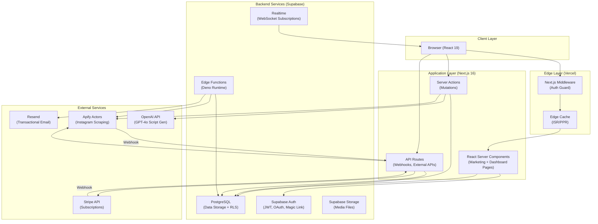
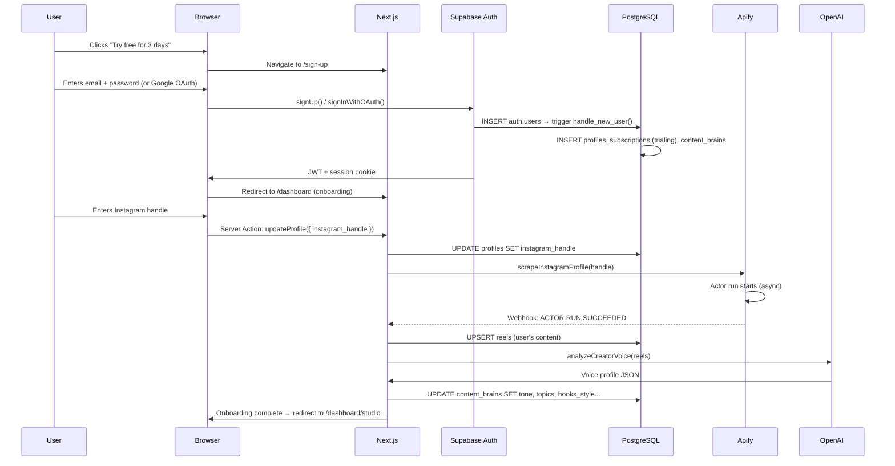
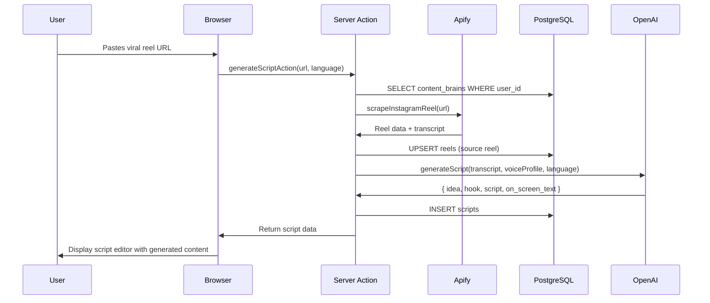
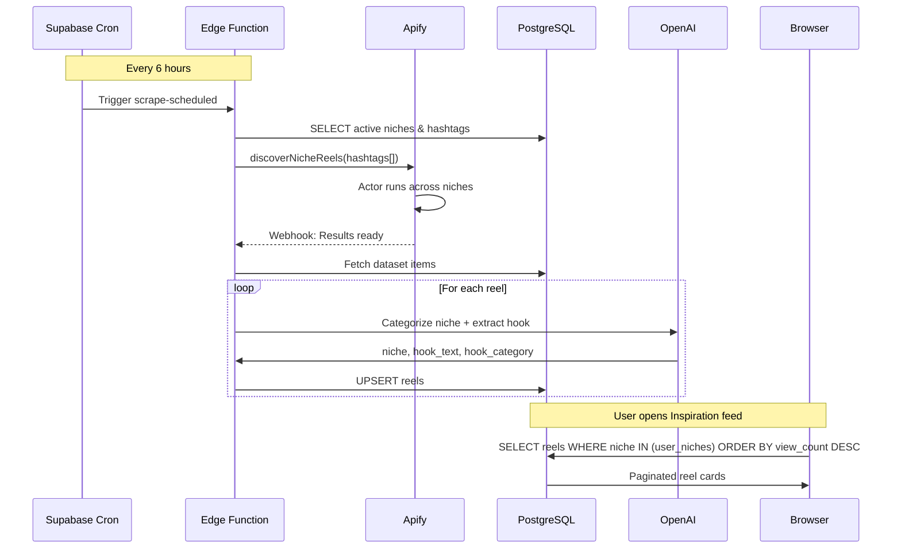
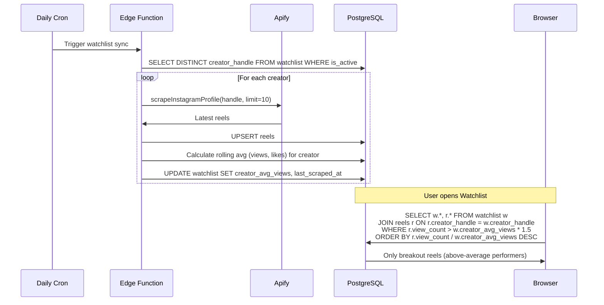
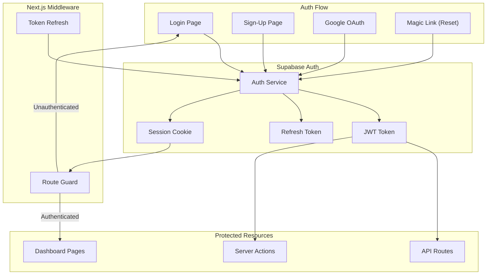
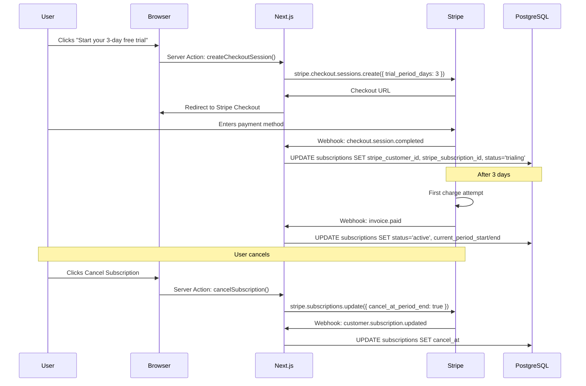

# 🏗️ Architecture Document

## InstaVibes — System Architecture

---

> **Version:** 1.0  
> **Date:** October 16, 2026  
> **Status:** Draft  
> **Author:** InstaVibes Engineering Team

---

## 1. Architecture Overview

InstaVibes follows a **modern serverless architecture** built on three pillars:

1. **Next.js 16** — Full-stack framework handling SSR, API routes, server actions, and static generation.
2. **Supabase** — Backend-as-a-Service providing PostgreSQL, authentication, realtime subscriptions, edge functions, and file storage.
3. **Apify** — External scraping infrastructure for Instagram data ingestion via managed actors.

```
┌─────────────────────────────────────────────────────────────────────┐
│                         ARCHITECTURE OVERVIEW                       │
│                                                                     │
│  ┌──────────┐    ┌──────────────────────────────────────────────┐   │
│  │  Client   │───▶│            Vercel Edge Network               │   │
│  │ (Browser) │◀───│  ┌────────────────────────────────────────┐ │   │
│  └──────────┘    │  │           Next.js 16 App                │ │   │
│                  │  │  ┌─────────┐ ┌──────────┐ ┌──────────┐ │ │   │
│                  │  │  │   RSC   │ │  Server  │ │   API    │ │ │   │
│                  │  │  │  Pages  │ │ Actions  │ │  Routes  │ │ │   │
│                  │  │  └────┬────┘ └────┬─────┘ └────┬─────┘ │ │   │
│                  │  └───────┼───────────┼────────────┼────────┘ │   │
│                  └──────────┼───────────┼────────────┼──────────┘   │
│                             │           │            │              │
│              ┌──────────────┼───────────┼────────────┼──────────┐   │
│              │              ▼           ▼            ▼          │   │
│              │         ┌──────────────────────────────────┐     │   │
│              │         │          Supabase                 │     │   │
│              │         │  ┌──────┐ ┌──────┐ ┌──────────┐ │     │   │
│              │         │  │ Auth │ │  DB  │ │ Edge Fns  │ │     │   │
│              │         │  │      │ │(PgSQL)│ │(Deno/Cron)│ │     │   │
│              │         │  └──────┘ └──────┘ └──────────┘ │     │   │
│              │         │  ┌──────┐ ┌──────────────────┐  │     │   │
│              │         │  │Storage│ │    Realtime      │  │     │   │
│              │         │  └──────┘ └──────────────────┘  │     │   │
│              │         └──────────────────────────────────┘     │   │
│              │                                                  │   │
│              │  ┌────────────┐  ┌──────────┐  ┌─────────────┐  │   │
│              │  │   Apify    │  │  OpenAI  │  │   Stripe    │  │   │
│              │  │  Actors    │  │  GPT-4o  │  │  Payments   │  │   │
│              │  └────────────┘  └──────────┘  └─────────────┘  │   │
│              │       External Services                          │   │
│              └──────────────────────────────────────────────────┘   │
└─────────────────────────────────────────────────────────────────────┘
```

---

## 2. System Components

### 2.1 Component Diagram



---

## 3. Data Flow Architecture

### 3.1 User Onboarding Flow



### 3.2 Script Generation Flow



### 3.3 Inspiration Feed Data Pipeline



### 3.4 Watchlist & Breakout Detection Flow



---

## 4. Authentication Architecture



### 4.1 Auth Provider Configuration

| Provider | Strategy | Configuration |
|----------|----------|---------------|
| **Email/Password** | Server-side signup | Email confirmation enabled, min 8 char password |
| **Google OAuth** | PKCE flow | Redirect to `/auth/callback` |
| **Magic Link** | Email-based | For password reset only |

### 4.2 Session Management

- **Access Token:** JWT, 1-hour expiry, stored in HTTP-only cookie
- **Refresh Token:** 7-day expiry, rotated on each use
- **Middleware Refresh:** Auto-refreshes tokens on each request via `@supabase/ssr`

### 4.3 Row Level Security (RLS) Model

```
┌──────────────────────────────────────────────────────┐
│                    RLS POLICY MAP                     │
├─────────────────┬────────────────────────────────────┤
│ profiles        │ users can CRUD own row only        │
│ subscriptions   │ users can READ own row only        │
│ content_brains  │ users can CRUD own row only        │
│ scripts         │ users can CRUD own rows only       │
│ watchlist       │ users can CRUD own rows only       │
│ collections     │ users can CRUD own rows only       │
│ collection_items│ users with matching collection_id  │
│ reels           │ all authenticated users can READ   │
│ scraper_jobs    │ users can READ own jobs only       │
└─────────────────┴────────────────────────────────────┘
```

---

## 5. Apify Scraping Architecture

### 5.1 Actor Orchestration

```
┌──────────────────────────────────────────────────────────────┐
│                   APIFY ACTOR ORCHESTRATION                   │
│                                                              │
│  ┌──────────────┐                                            │
│  │  On-Demand   │  ← User pastes URL or adds to watchlist   │
│  │  Triggers    │                                            │
│  └──────┬───────┘                                            │
│         │                                                    │
│         ▼                                                    │
│  ┌──────────────────────────────────────────────────┐       │
│  │              Apify Actor Runs                     │       │
│  │  ┌──────────────┐  ┌──────────────────────────┐  │       │
│  │  │ instagram-   │  │ instagram-reel-scraper   │  │       │
│  │  │ scraper      │  │ (single reel data)       │  │       │
│  │  │ (profile     │  └──────────────────────────┘  │       │
│  │  │  posts)      │  ┌──────────────────────────┐  │       │
│  │  └──────────────┘  │ instagram-hashtag-       │  │       │
│  │                    │ scraper (niche discovery) │  │       │
│  │                    └──────────────────────────┘  │       │
│  └───────────────────────┬──────────────────────────┘       │
│                          │                                   │
│                          ▼                                   │
│  ┌──────────────────────────────────────────────────┐       │
│  │              Webhook Callback                     │       │
│  │  POST /api/apify/webhook                         │       │
│  │  → Verify signature                              │       │
│  │  → Fetch dataset                                 │       │
│  │  → Parse & normalize data                        │       │
│  │  → UPSERT into reels table                       │       │
│  │  → Update scraper_jobs status                    │       │
│  └──────────────────────────────────────────────────┘       │
│                                                              │
│  ┌──────────────┐                                            │
│  │  Scheduled   │  ← Supabase pg_cron / Edge Functions      │
│  │  Triggers    │                                            │
│  │              │  Every 6h: Niche hashtag discovery          │
│  │              │  Every 24h: Watchlist creator sync          │
│  └──────────────┘                                            │
└──────────────────────────────────────────────────────────────┘
```

### 5.2 Data Normalization Pipeline

```
Apify Raw Data → Parser → Normalized Reel Object → Supabase UPSERT

Parser responsibilities:
├── Extract platform-specific IDs
├── Normalize engagement metrics
├── Calculate engagement_rate = (likes + comments) / views
├── Extract caption text and hashtags
├── Parse audio/music metadata
├── Generate thumbnail URLs
└── Map to reels table schema
```

### 5.3 Rate Limiting & Cost Control

| Control | Strategy |
|---------|----------|
| **Actor Concurrency** | Max 3 concurrent actor runs per user |
| **Daily Limits** | Max 100 reel scrapes per user per day |
| **Request Queuing** | Bull queue (or Supabase pgmq) for actor run requests |
| **Deduplication** | UPSERT on `(platform, platform_id)` to prevent duplicate scrapes |
| **Caching** | 24-hour cache on reel data; skip re-scrape if recent |
| **Proxy Rotation** | Apify's built-in proxy pool for IP rotation |

---

## 6. AI Pipeline Architecture

### 6.1 LLM Integration

```
┌──────────────────────────────────────────────────────────────┐
│                     AI PIPELINE                               │
│                                                              │
│  ┌──────────────────────────────────────────────────┐       │
│  │              Voice Analysis                       │       │
│  │                                                   │       │
│  │  User's reels (30) → Transcripts + Captions      │       │
│  │       │                                           │       │
│  │       ▼                                           │       │
│  │  GPT-4o (System: Voice Analyzer)                  │       │
│  │       │                                           │       │
│  │       ▼                                           │       │
│  │  JSON: { tone, topics, hooks_style, audience,     │       │
│  │         offers, storytelling, language }           │       │
│  │       │                                           │       │
│  │       ▼                                           │       │
│  │  content_brains table (persisted)                 │       │
│  └──────────────────────────────────────────────────┘       │
│                                                              │
│  ┌──────────────────────────────────────────────────┐       │
│  │              Script Generation                    │       │
│  │                                                   │       │
│  │  Source Reel Transcript + Voice Profile            │       │
│  │       │                                           │       │
│  │       ▼                                           │       │
│  │  GPT-4o (System: Script Writer)                   │       │
│  │  Temperature: 0.8, Max tokens: 2000               │       │
│  │  Response format: JSON                            │       │
│  │       │                                           │       │
│  │       ▼                                           │       │
│  │  { idea, hook, script, on_screen_text }           │       │
│  │       │                                           │       │
│  │       ▼                                           │       │
│  │  scripts table (persisted)                        │       │
│  └──────────────────────────────────────────────────┘       │
│                                                              │
│  ┌──────────────────────────────────────────────────┐       │
│  │              Reel Categorization                   │       │
│  │                                                   │       │
│  │  Reel caption + transcript                        │       │
│  │       │                                           │       │
│  │       ▼                                           │       │
│  │  GPT-4o-mini (System: Categorizer)                │       │
│  │  Temperature: 0.2 (deterministic)                 │       │
│  │       │                                           │       │
│  │       ▼                                           │       │
│  │  { niche, hook_text, hook_category }              │       │
│  └──────────────────────────────────────────────────┘       │
└──────────────────────────────────────────────────────────────┘
```

### 6.2 Prompt Management

| Prompt | Model | Temperature | Max Tokens | Format |
|--------|-------|-------------|------------|--------|
| Voice Analyzer | GPT-4o | 0.3 | 1500 | JSON |
| Script Generator | GPT-4o | 0.8 | 2000 | JSON |
| Reel Categorizer | GPT-4o-mini | 0.2 | 500 | JSON |
| Hook Extractor | GPT-4o-mini | 0.2 | 200 | JSON |

---

## 7. Payment & Subscription Architecture



### 7.1 Subscription States

```
                  ┌─────────┐
     Sign Up ───▶ │ TRIALING│ ──3 days──▶ Payment Success ──▶ ACTIVE
                  └────┬────┘                                    │
                       │                                         │
                  Payment Fails                             Cancel Request
                       │                                         │
                       ▼                                         ▼
                  ┌─────────┐                            ┌──────────────┐
                  │INCOMPLETE│                            │  ACTIVE      │
                  └─────────┘                            │(cancel_at set)│
                                                         └──────┬───────┘
                                                                │
                                                          Period Ends
                                                                │
                                                                ▼
                                                         ┌──────────┐
                                                         │ CANCELED  │
                                                         └──────────┘
```

### 7.2 Feature Gating

```typescript
// Middleware-level subscription check
function requireActiveSubscription(user: User, subscription: Subscription) {
  const isActive = ['trialing', 'active'].includes(subscription.status);
  const isWithinPeriod = new Date() < new Date(subscription.current_period_end);
  
  if (!isActive || !isWithinPeriod) {
    redirect('/dashboard/settings?upgrade=true');
  }
}
```

---

## 8. Deployment Architecture

### 8.1 Infrastructure Diagram

```
┌──────────────────────────────────────────────────────────────┐
│                    DEPLOYMENT TOPOLOGY                        │
│                                                              │
│  ┌────────────────────────────────────────────────────────┐ │
│  │                   Vercel Platform                       │ │
│  │                                                        │ │
│  │  ┌──────────────┐  ┌────────────┐  ┌──────────────┐  │ │
│  │  │ Edge Network  │  │ Serverless │  │   Static     │  │ │
│  │  │ (CDN + WAF)  │  │ Functions  │  │   Assets     │  │ │
│  │  │              │  │ (Node 20)  │  │ (S3/R2)      │  │ │
│  │  │ - Middleware  │  │            │  │              │  │ │
│  │  │ - ISR Cache  │  │ - API Rts  │  │ - Images     │  │ │
│  │  │ - PPR Shell  │  │ - Actions  │  │ - Fonts      │  │ │
│  │  └──────────────┘  └────────────┘  │ - Videos     │  │ │
│  │                                    └──────────────┘  │ │
│  └────────────────────────────────────────────────────────┘ │
│                              │                               │
│                              ▼                               │
│  ┌────────────────────────────────────────────────────────┐ │
│  │                 Supabase Cloud                          │ │
│  │                                                        │ │
│  │  Region: ap-south-1 (Mumbai) or us-east-1              │ │
│  │                                                        │ │
│  │  ┌──────────┐  ┌──────────┐  ┌──────────────────────┐│ │
│  │  │PostgreSQL│  │   Auth   │  │   Edge Functions     ││ │
│  │  │(Dedicated│  │ (GoTrue) │  │   (Deno Runtime)     ││ │
│  │  │ or Shared│  │          │  │                      ││ │
│  │  │ Compute) │  │          │  │  - scrape-scheduled  ││ │
│  │  └──────────┘  └──────────┘  │  - process-webhook   ││ │
│  │  ┌──────────┐  ┌──────────┐  └──────────────────────┘│ │
│  │  │ Storage  │  │ Realtime │                           │ │
│  │  │ (S3)     │  │(WebSocket│                           │ │
│  │  └──────────┘  └──────────┘                           │ │
│  └────────────────────────────────────────────────────────┘ │
│                                                              │
│  ┌──────────────────────────────────────────────────────┐   │
│  │              External Services                        │   │
│  │  ┌──────────┐  ┌──────────┐  ┌─────────────────┐   │   │
│  │  │  Apify   │  │  OpenAI  │  │     Stripe      │   │   │
│  │  │  Cloud   │  │  API     │  │   (Payments)    │   │   │
│  │  └──────────┘  └──────────┘  └─────────────────┘   │   │
│  │  ┌──────────┐  ┌──────────┐                         │   │
│  │  │  Resend  │  │  Sentry  │                         │   │
│  │  │  (Email) │  │ (Errors) │                         │   │
│  │  └──────────┘  └──────────┘                         │   │
│  └──────────────────────────────────────────────────────┘   │
└──────────────────────────────────────────────────────────────┘
```

### 8.2 CI/CD Pipeline

```
┌──────────┐    ┌──────────┐    ┌──────────┐    ┌──────────┐
│  GitHub  │───▶│ GitHub   │───▶│  Vercel  │───▶│Production│
│  Push    │    │ Actions  │    │  Build   │    │  Deploy  │
└──────────┘    └──────────┘    └──────────┘    └──────────┘
                     │
                     ├── Lint (ESLint)
                     ├── Type Check (tsc)
                     ├── Unit Tests (Vitest)
                     ├── E2E Tests (Playwright)
                     └── Supabase Migrations
```

### 8.3 Environment Strategy

| Environment | Purpose | Database | URL |
|-------------|---------|----------|-----|
| **Development** | Local dev | Supabase local (Docker) | `localhost:3000` |
| **Preview** | PR previews | Supabase staging project | `*.vercel.app` |
| **Production** | Live app | Supabase production project | `www.instavibes.com` |

---

## 9. Caching Strategy

### 9.1 Cache Layers

```
┌─────────────────────────────────────────────────────┐
│                  CACHING LAYERS                      │
│                                                     │
│  Layer 1: Vercel Edge Cache                         │
│  ├── ISR pages: Marketing pages (revalidate: 3600)  │
│  ├── PPR shells: Static shell + dynamic slots       │
│  └── Static assets: Fonts, images (immutable)       │
│                                                     │
│  Layer 2: React Cache (Server)                      │
│  ├── React.cache() for deduplicated DB queries      │
│  └── unstable_cache() for expensive computations    │
│                                                     │
│  Layer 3: Client Cache                              │
│  ├── React Query / SWR for dashboard data           │
│  ├── Optimistic updates for mutations               │
│  └── Browser cache for static assets                │
│                                                     │
│  Layer 4: Database Cache                            │
│  ├── PostgreSQL query cache                         │
│  ├── Materialized views for feed aggregations       │
│  └── pg_stat for query optimization                 │
└─────────────────────────────────────────────────────┘
```

### 9.2 Cache Invalidation

| Data Type | Strategy | TTL |
|-----------|----------|-----|
| Marketing pages | ISR + on-demand revalidation | 1 hour |
| Reels feed | SWR + background revalidation | 5 minutes |
| User scripts | Revalidate on mutation (server action) | Instant |
| Voice profile | Cache until explicitly updated | Persistent |
| Reel data (scraped) | Stored in DB, never cached in CDN | N/A |

---

## 10. Security Architecture

### 10.1 Security Layers

```
┌──────────────────────────────────────────────────────────────┐
│                    SECURITY MODEL                             │
│                                                              │
│  Layer 1: Network                                            │
│  ├── HTTPS everywhere (TLS 1.3)                              │
│  ├── Vercel WAF (DDoS protection)                            │
│  └── CORS: Restrict to app domain                            │
│                                                              │
│  Layer 2: Authentication                                     │
│  ├── Supabase Auth (JWT + refresh tokens)                    │
│  ├── Next.js Middleware (route protection)                    │
│  ├── Google OAuth (PKCE flow)                                │
│  └── Email verification required                             │
│                                                              │
│  Layer 3: Authorization                                      │
│  ├── Row Level Security (RLS) on ALL tables                  │
│  ├── Service role key: Server-side only, never exposed       │
│  ├── Anon key: Client-side, limited by RLS policies          │
│  └── Subscription status checks for feature gating           │
│                                                              │
│  Layer 4: Data Protection                                    │
│  ├── Input validation: Zod schemas on all server actions     │
│  ├── URL sanitization: Validate & sanitize user-provided URLs│
│  ├── SQL injection: Prevented by Supabase client (parameterized) │
│  ├── XSS: React's default escaping + CSP headers            │
│  └── CSRF: Same-origin server actions                        │
│                                                              │
│  Layer 5: External API Security                              │
│  ├── Apify webhook signature verification                    │
│  ├── Stripe webhook signature verification                   │
│  ├── Internal API key for server-to-server calls             │
│  └── API rate limiting per user (token bucket)               │
│                                                              │
│  Layer 6: Secrets Management                                 │
│  ├── Vercel encrypted environment variables                  │
│  ├── Supabase vault for sensitive config                     │
│  └── .env.local for development (git-ignored)                │
└──────────────────────────────────────────────────────────────┘
```

### 10.2 Rate Limiting

| Endpoint | Limit | Window |
|----------|-------|--------|
| `/api/ai/generate-script` | 20 requests | Per user per hour |
| `/api/apify/scrape-profile` | 10 requests | Per user per day |
| `/api/apify/scrape-reel` | 50 requests | Per user per day |
| `/api/auth/*` | 10 requests | Per IP per minute |
| General API | 100 requests | Per user per minute |

---

## 11. Error Handling Architecture

### 11.1 Error Boundary Strategy

```
Root Layout
├── Global Error Boundary (error.tsx)
│   └── Catches unhandled errors, shows recovery UI
├── Dashboard Layout
│   └── Dashboard Error Boundary (error.tsx)
│       └── Catches dashboard errors, maintains nav
└── Page-level Suspense
    └── Loading states for async components
```

### 11.2 Error Classification

| Category | Handler | User Impact |
|----------|---------|-------------|
| **Network Errors** | Retry with exponential backoff | Toast notification |
| **Auth Errors** | Redirect to login | Session expired message |
| **Validation Errors** | Inline form errors (Zod) | Field-level feedback |
| **AI Generation Errors** | Fallback prompt + retry | "Try again" button |
| **Scraping Errors** | Job marked as failed | Status notification |
| **Payment Errors** | Stripe error handling | Redirect to billing |

---

## 12. Monitoring & Observability

### 12.1 Monitoring Stack

```
┌──────────────────────────────────────────────────────┐
│                 OBSERVABILITY STACK                    │
│                                                      │
│  ┌──────────────┐  ┌──────────────┐  ┌────────────┐│
│  │   Vercel     │  │    Sentry    │  │  Supabase  ││
│  │  Analytics   │  │              │  │  Dashboard ││
│  │              │  │  - Errors    │  │            ││
│  │  - Web Vitals│  │  - Traces    │  │  - DB Perf ││
│  │  - Page Speed│  │  - Sessions  │  │  - Auth Log││
│  │  - Traffic   │  │  - Releases  │  │  - RLS Log ││
│  └──────────────┘  └──────────────┘  └────────────┘│
│                                                      │
│  ┌──────────────┐  ┌──────────────┐  ┌────────────┐│
│  │   Stripe     │  │    Apify     │  │   Resend   ││
│  │  Dashboard   │  │   Console    │  │  Dashboard ││
│  │              │  │              │  │            ││
│  │  - Revenue   │  │  - Actor Runs│  │  - Email   ││
│  │  - Churn     │  │  - Costs     │  │    Delivery││
│  │  - MRR       │  │  - Failures  │  │  - Bounces ││
│  └──────────────┘  └──────────────┘  └────────────┘│
└──────────────────────────────────────────────────────┘
```

### 12.2 Key Metrics to Track

| Category | Metric | Alert Threshold |
|----------|--------|-----------------|
| **Performance** | LCP | > 3s |
| **Performance** | FCP | > 1.5s |
| **Availability** | Error rate | > 1% |
| **Scraping** | Actor failure rate | > 10% |
| **AI** | Script generation latency | > 10s |
| **Business** | Trial → Paid conversion | < 10% |
| **Business** | Daily active users | < 50% of total |

---

## 13. Scalability Considerations

### 13.1 Horizontal Scaling Points

| Component | Scaling Strategy |
|-----------|-----------------|
| **Next.js** | Vercel auto-scales serverless functions |
| **PostgreSQL** | Supabase compute add-ons, read replicas (Pro plan) |
| **Apify** | Concurrent actor runs, proxy pool scaling |
| **AI** | Rate-limited by OpenAI quotas; implement request queuing |
| **Storage** | Supabase Storage (S3-backed, unlimited) |

### 13.2 Database Optimization

| Optimization | Implementation |
|-------------|---------------|
| **Indexes** | Composite indexes on frequently filtered columns |
| **Pagination** | Cursor-based pagination (keyset) for feeds |
| **Connection Pooling** | Supavisor (built into Supabase) |
| **Materialized Views** | Pre-computed feed aggregations for heavy queries |
| **Partitioning** | Time-based partitioning on `reels` table if > 10M rows |

### 13.3 Estimated Load Projections

| Milestone | Users | Reels in DB | Daily API Calls | DB Size |
|-----------|-------|-------------|-----------------|---------|
| Launch | 500 | 50,000 | 10,000 | 500 MB |
| 3 months | 5,000 | 500,000 | 100,000 | 5 GB |
| 6 months | 15,000 | 2,000,000 | 300,000 | 20 GB |
| 12 months | 50,000 | 10,000,000 | 1,000,000 | 100 GB |

---

## 14. Disaster Recovery & Backup

| Strategy | Implementation |
|----------|---------------|
| **Database Backups** | Supabase automatic daily backups (Pro plan: point-in-time recovery) |
| **Code** | GitHub repository with branch protection |
| **Secrets** | Vercel encrypted env vars, rotated quarterly |
| **Rollback** | Vercel instant rollback to any previous deployment |
| **Data Export** | Supabase pg_dump for manual backups |

---

## 15. Technology Decision Log

| Decision | Choice | Rationale | Alternatives Considered |
|----------|--------|-----------|------------------------|
| Framework | Next.js 16 | SSR/SSG, React Server Components, Server Actions, Vercel integration | Remix, Nuxt, SvelteKit |
| Database | Supabase (PostgreSQL) | Integrated auth, RLS, realtime, edge functions, generous free tier | PlanetScale, Neon, Firebase |
| Scraping | Apify | Managed infrastructure, proxy rotation, webhooks, pre-built Instagram actors | Custom scraping (Puppeteer), Bright Data, ScrapingBee |
| AI | OpenAI GPT-4o | Best quality for creative writing, JSON mode, fast inference | Anthropic Claude, Google Gemini, Llama (self-hosted) |
| Payments | Stripe | Industry standard, webhooks, subscription management, global coverage | Razorpay (India-only), Paddle, LemonSqueezy |
| Styling | Tailwind CSS v4 | Utility-first, consistent with AlgroHack's implementation, great DX | Vanilla CSS, Styled Components, CSS Modules |
| Deployment | Vercel | Native Next.js support, edge network, instant rollbacks, preview deploys | AWS Amplify, Cloudflare Pages, Railway |

---

*This architecture document provides the complete system design for InstaVibes. It should be updated as the system evolves and new requirements emerge.*
